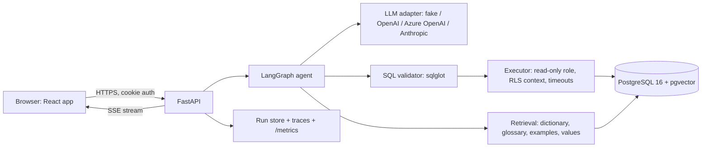
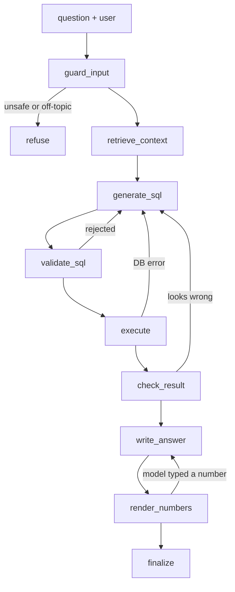

# Agentic SQL Analyst: Build Guide

> Ask a company database questions in plain English or Bahasa Indonesia, and get answers you can check: the SQL, the rows behind it, and numbers filled in by code, never typed by the model.

Written 2026-10-29 for a fresh Claude Code session. Rules: `CLAUDE.md`. State: `PROGRESS.md`.

---

## 0. How to use this guide

**Baron:** open a new Claude Code session with `D:\Portfolios\agentic-sql-analyst` as the working folder and paste the kickoff prompt from §17. Work one phase per session (a big phase may take two or three). In each session:
1. review Claude's plan;
2. approve it;
3. check the Definition of Done output;
4. let Claude commit and update `PROGRESS.md`.

**Claude:** this file is the spec. Follow the phases in §13 in order. Each phase lists tasks and a Definition of Done (DoD). Library APIs change: if anything here is outdated, say so, propose an alternative, and log it in `docs/DECISIONS.md`.

---

## 1. What we're building, and why

**The product.** A natural-language query (NLQ) agent over an enterprise-style PostgreSQL database for **PT Arunika Niaga (fictional)**, an Indonesian omnichannel retailer. A user signs in and asks, for example:
- "Which 5 product categories had the highest net revenue in FY2025 Q2, by channel?"
- "Berapa return rate per kota bulan lalu?"

The agent:
1. finds the relevant tables, metric definitions, and values;
2. writes PostgreSQL;
3. validates and runs it safely, repairing it if it fails;
4. checks the result;
5. replies in the question's language, with the SQL, a result table, a chart, its assumptions, and the cost and latency.

**Four guarantees.** These are the headline of the README, like "can't cite a source it didn't gather" in the flagship project.
1. **Read-only by construction.** Three independent layers (SQL validator, read-only transaction, read-only database role). Any one of them alone blocks writes.
2. **You only see what you're allowed to see.** Row-level security and masked views are enforced by Postgres, not by the prompt. A regional manager can't see another region's rows, even with hand-written SQL.
3. **The model never types a number.** The model writes an answer *template* with slots. Code fills every number from the query result. A check rejects any digit the model wrote itself (unless it came from the question).
4. **It shows its work.** Every answer comes with the SQL, the rows, the assumptions, and the tokens, cost, and latency.

Plus **honest evaluation**: a held-out test set, a single-prompt baseline, ablations, repeated runs reported as mean ± std, and null results published.

**Why this project** (gaps found in October 2026 job ads):

| Job ad asked for | This project shows it |
|---|---|
| NLQ agents over enterprise data (EY) | the whole product |
| SQL + enterprise data model (EY) | about 22-table schema, semantic glossary, data dictionary |
| React front-end, streaming responses, authentication (EY) | React + TypeScript UI, SSE streaming, cookie auth with roles |
| Azure preferred, Docker, FastAPI, CI/CD, basic cloud security (EY) | Phase 8, CI, threat model |
| Eval harnesses, golden datasets, "deterministic code beats a model call" (IFS Nexus Black) | §9, guarantees 1–3 |
| Agent platform: orchestration, tools, logging, observability (Sea Labs) | LangGraph agent, tracing, `/metrics` |

---

## 2. Scope

**In scope:** single-database NLQ over read-only views; English and Bahasa Indonesia; two user roles; streaming UI; evaluation; deployment; docs.

**Out of scope:** writing or editing data; joining across several databases; fine-tuning; real or personal data; a dashboard builder; long chat memory. A single follow-up question is a stretch goal.

---

## 3. Architecture



**Agent graph.** Every edge also passes through a budget guard (max LLM calls, tokens, cost, wall time). When it trips, the run stops cleanly with an explanation.



Repairs (back to `generate_sql`) are capped at 3 per run. `write_answer` retries once; after that the run falls back to "here is the table" with no prose.

---

## 4. Tech stack and prerequisites

| Area | Choice | Notes |
|---|---|---|
| Python | 3.12, `uv`, `ruff`, `pytest`, `poethepoet` tasks | cross-platform task runner (no `make` on Windows) |
| Agent | LangGraph | typed state, conditional edges |
| SQL parsing | `sqlglot` (postgres dialect) | AST-based validation, never regex |
| DB | PostgreSQL 16 + pgvector (`pgvector/pgvector:pg16` image), `psycopg` 3 + pool | |
| Embeddings | local `fastembed` (ONNX, small BGE model) | keyless and free; vectors stored in pgvector |
| Lexical search | BM25 (`rank-bm25` or Postgres full-text) | fused with vectors by reciprocal-rank fusion |
| API | FastAPI, Pydantic v2, SSE via `StreamingResponse` | |
| Auth | argon2 password hashes, JWT in an httpOnly cookie | demo users seeded |
| Web | React + TypeScript + Vite, Tailwind, Recharts, Vitest, Playwright (one smoke test) | |
| Infra | Docker Compose; GitHub Actions | |
| Deploy | Azure Container Apps + Azure Database for PostgreSQL, or the existing AWS EC2 | decided in Phase 8 |

**Baron installs:** Git, Docker Desktop, `uv`, Node LTS. Claude can install Python packages itself.

---

## 5. Repository layout (target)

```
agentic-sql-analyst/
  CLAUDE.md  BUILD_GUIDE.md  PROGRESS.md  README.md  .env.example  .gitignore
  pyproject.toml  uv.lock  docker-compose.yml
  backend/
    src/sql_analyst/
      config.py              # settings from env (pydantic-settings)
      db/                    # schema.sql, views.sql, roles.sql, rls.sql, seed.py
      dictionary/            # loader + models for data/dictionary.yaml
      safety/                # validator.py, executor.py, cost_guard.py
      retrieval/             # index.py, search.py, values.py
      llm/                   # base.py, fake.py, openai.py, azure_openai.py, anthropic.py, pricing.py
      agent/                 # state.py, graph.py, nodes/, budget.py, render.py, prompts/
      api/                   # main.py, auth.py, routes/, streaming.py, ratelimit.py
      observability.py       # run traces, cost, latency, /metrics aggregation
      cli.py                 # `ask` command
    tests/                   # unit/, safety/, agent/, api/
  data/
    dictionary.yaml          # tables, columns, PII flags, synonyms (EN/ID), glossary metrics, join paths
    examples.yaml            # few-shot library; must not overlap the eval set
  eval/
    cases/dev.yaml  cases/test.yaml
    run_eval.py  metrics.py  baseline.py
    results/                 # committed JSON + markdown summaries
  web/                       # React app
  infra/                     # Dockerfiles, Caddyfile or Azure notes
  docs/                      # DECISIONS.md, DATA.md, SECURITY.md, ARCHITECTURE.md, EVAL_RESULTS.md, DEPLOYMENT.md
  .github/workflows/ci.yml
```

---

## 6. The database: PT Arunika Niaga (fictional)

**Data rules.**
- Fully synthetic, generated by a deterministic seed script (`seed=42`; Faker `id_ID` locale).
- Covers Jan 2024 to Sep 2026: roughly 60k orders, 150k order items, 20k customers, 40 stores in about 12 Indonesian cities, 4 channels (store, website, app, marketplace).
- Rebuilding twice must produce identical data (checksum test).
- Realistic patterns: weekday/weekend rhythm, Ramadan and Lebaran peaks (look up the real date ranges for each year), Harbolnas 11.11 and 12.12 spikes, a slowly growing online share.

**Two schemas.**
- `core`: raw tables, including personal data. **The agent's role has no access to it.**
- `analytics`: views the agent can read. Personal data is masked or left out.

**Analytics views (about 22):**

| Domain | Views |
|---|---|
| Calendar and places | `dim_date` (calendar and **fiscal year starting 1 April**; FY2025 = 1 Apr 2025 to 31 Mar 2026), `dim_region` (province, city, region group), `dim_store`, `dim_channel` |
| Products | `dim_category` (2-level hierarchy), `dim_product` (`is_active` soft delete), `dim_supplier` |
| Customers | `dim_customer` (id, segment, city, signup date: **no name, email, or phone**) |
| Sales | `fact_orders` (status: completed / cancelled / refunded), `fact_order_items` (price and discount per line, IDR as BIGINT), `fact_payments` (QRIS, e-wallet, card, bank transfer, COD), `fact_returns` (partial returns), `fact_shipments` |
| Supply | `fact_inventory_daily`, `fact_purchase_orders` |
| Marketing | `dim_promotion`, `fact_promotion_redemptions`, `fact_web_sessions` (funnel) |
| Service | `fact_support_tickets` (with free-text subject) |
| People | `dim_employee` (no salary), `fact_sales_targets`, `fact_store_daily_traffic` |

**Deliberate real-world traps.** These are what make NLQ hard, and they draw on Baron's Head of Data experience:
- Timestamps are stored in UTC, but business days are WIB (UTC+7).
- Cancelled orders must be excluded from revenue.
- The fiscal year differs from the calendar year.
- `fact_orders.region_code` is deprecated (use store → region instead). The dictionary marks it.
- Inconsistent names (`amount_idr` vs `total_amount`).
- One support-ticket subject contains a planted prompt injection ("ignore previous instructions and …") to test hostile data.

**`data/dictionary.yaml`** is the semantic layer. For every view and column it holds:
- a description, the type, and a PII flag;
- example values (for categorical columns);
- synonyms in English and Indonesian (omzet, penjualan, pendapatan, pelanggan, cabang, toko, kuartal, bulan lalu, …).

It also lists join paths, plus **glossary metrics with canonical SQL**:
- gross sales;
- net revenue (excludes cancelled orders, line discounts, and refunds);
- AOV (average order value);
- return rate (returned units ÷ sold units);
- active customers (≥1 completed order in the last 90 days);
- conversion rate.

A test fails if any `analytics` column lacks a description, or if any glossary SQL fails to run.

**Value index.** Distinct values of categorical columns (cities, categories, channels, statuses, payment methods) are stored for fuzzy matching, so that "Jkt", "Jabodetabek", or "kategori elektronik" map to real values.

---

## 7. Safety design (defense in depth)

Build this **before** any LLM code (Phase 2). Treat the model as untrusted input.

| Layer | What it does |
|---|---|
| 1. Input guard | Length limit (500 characters). Write intents (delete/update/drop), requests for personal data, and off-topic questions get a polite refusal. |
| 2. SQL validator (sqlglot AST) | One statement only. `SELECT`/`WITH` only (no DML, DDL, `COPY`, `CALL`, `SET`, transaction control, `SELECT … INTO`, locking clauses). Only `analytics` views and dictionary columns. Function deny-list (`pg_sleep`, `pg_read_file`, `lo_*`, `dblink`, `set_config`, `current_setting` misuse, and so on). No system catalogs. Personal-data columns rejected. |
| 3. Row cap | The query is wrapped in an outer `LIMIT 1000`; the UI shows when results were truncated. |
| 4. Cost guard | `EXPLAIN (FORMAT JSON)` before running; plans over a cost threshold are rejected (catches accidental cross joins). |
| 5. Executor | Separate role `nlq_reader` with `SELECT` on `analytics` only, `default_transaction_read_only = on`, a read-only transaction, `statement_timeout` 5 s, and a connection pool. |
| 6. Row-level security | Policies on region-scoped views keyed on a per-request setting (`SET LOCAL app.region_ids = …`) issued by the executor from the signed-in user, never from the model. |
| 7. Hostile data | Result rows go to the model as delimited JSON data, never as instructions. Answers are templates (guarantee 3). The planted injection row has an eval case. |
| 8. Budget guard | Max LLM calls, tokens, cost, and wall time per run; repair loop ≤ 3. API: rate limit, daily spend cap, kill switch. |

**Defense-in-depth tests are required:**
- Bypass the validator and send `DELETE` straight to the executor: the database must refuse.
- Run the manager role's hand-written SQL against another region: zero rows.

`docs/SECURITY.md` holds a threat → layer(s) → test table.

---

## 8. Agent design

### 8.1 State (Pydantic)

`question`, `user` (id, role, region_ids), `lang` (en/id), `context` (tables, columns, glossary hits, value matches, examples), `sql`, `sql_attempts` (list of sql + error), `assumptions`, `result` (columns, rows, row_count, truncated), `answer_template`, `answer`, `chart` (type, x, y), `status`, `trace` (per-node timings; per-call tokens and cost), `budget`.

### 8.2 Nodes

1. **guard_input**: deterministic checks first, then (optionally) one cheap classification call: answerable data question / write request / personal-data request / off-topic / unanswerable with this data.
2. **retrieve_context**: hybrid search (BM25 + vector, RRF) over dictionary chunks and glossary; value-index matches; 3–5 similar examples from `data/examples.yaml`. Returns a compact, ranked context. Dumping the whole schema is the *baseline*, not the agent.
3. **generate_sql**: structured output `{sql, tables_used, assumptions[], confidence}`. The prompt order is fixed for caching: static instructions + dialect rules + glossary first, then the retrieved context, then the question and any previous error. Repair turns include the validator or database error.
4. **validate_sql**: deterministic layers 2–4 from §7.
5. **execute**: layer 5–6 executor.
6. **check_result**: deterministic checks (empty result, all-NULL columns, row cap hit, implausible magnitudes), then an optional critic call ("does this result answer the question?") that may send the run back once. Whether the critic helps is measured as an ablation, not assumed.
7. **write_answer**: structured output `{template, chart, caveats}`. The template uses slots such as `{{r0.net_revenue}}`, `{{sum.net_revenue}}`, `{{row_count}}`. Derived numbers (growth %, share) must be computed in SQL, not by the model.
8. **render_numbers**: fills slots with locale-aware formatting (IDR as `Rp 1,2 miliar` in Indonesian, `IDR 1.2B` in English). It **rejects any digit in the model's text that doesn't appear in the question** (years, "top 5"). Retries `write_answer` once, then falls back to a table-only answer.
9. **finalize**: assembles the response and persists the run (question, SQL, result sample, answer, trace).

### 8.3 LLM adapters

Interface: `generate_structured(messages, schema) -> (parsed_object, usage)` plus `name` and `pricing`. Adapters:
- **`fake`**: deterministic and rule-based, for tests and keyless demo questions. Its outputs are labelled "keyless" everywhere.
- **`openai`**, **`azure_openai`**, **`anthropic`**: live providers. Phase 4 builds `fake` plus the one live provider Baron picks; the others come later and are cheap to add.

Anthropic notes (use the `claude-api` skill when writing this adapter):
- Use structured outputs, not forced tool choice.
- Don't send `temperature`, `top_p`, or `top_k`, and don't prefill the assistant turn.
- Put a cache breakpoint after the static system prompt.

### 8.4 Model choice and cost

**Choosing the model is Baron's decision, made with the eval in Phase 7.** The model is configurable per node through env vars. Prices below are Anthropic list prices per million tokens, as of October 2026:

| Option | Model ID | Input / output per 1M tokens | Notes |
|---|---|---|---|
| Claude Opus 5.5 | `claude-opus-5-5` | $4 / $20 | highest quality; thinking always on (adds output tokens) |
| Claude Sonnet 5.5 | `claude-sonnet-5-5` | $2 / $10 | middle ground |
| Claude Haiku 5.5 | `claude-haiku-5-5` | $0.10 / $0.50 | cheapest Claude |
| OpenAI | `gpt-4o-mini` (or its current equivalent) | check the current price list | used in the flagship (~$0.001–0.002 per run) |
| Azure OpenAI | your deployment name | check the Azure price list | for "Azure preferred" roles |

**Rough cost per question.** Estimates only: the cost tracker measures the real numbers. A question takes about 2–4 calls, each about 4–6k input tokens and a few hundred to ~1.5k output tokens.

| Model | Per question | One eval run (100 questions × 3 repeats) |
|---|---|---|
| Haiku 5.5 | ≈ $0.005 | ≈ $1.5 |
| Sonnet 5.5 | ≈ $0.05–0.10 | ≈ $15–30 |
| Opus 5.5 | ≈ $0.10–0.25 | ≈ $30–75 |

Prompt caching of the static prefix lowers these. Always show Baron the estimate before a live run.

### 8.5 Tracing

Every run records:
- per node: duration;
- per LLM call: model, input/output/cached tokens, and cost (from `llm/pricing.py`);
- totals.

`GET /api/metrics` aggregates p50/p95 latency, runs, error rate, cost today, and cache-hit tokens. LangSmith tracing turns on only if `LANGSMITH_API_KEY` is set (stretch goal).

---

## 9. Evaluation design

**Cases:** about 100 YAML cases.
- **Splits:** `dev` (about 40, used for tuning) and `test` (about 60, used only for reported numbers).
- **Language:** about 20% Indonesian.

```yaml
- id: t017
  question: "Berapa net revenue per channel di FY2025 Q2?"
  lang: id
  category: metric_definition   # lookup | aggregation | join | time | metric_definition | ambiguous | unanswerable | adversarial | access_control
  difficulty: medium
  user: analyst                 # or manager_jakarta
  expected: answer              # answer | refuse_unsafe | refuse_unanswerable | state_assumption
  gold_sql: |
    SELECT ...
  order_matters: false
```

**Metrics:**

| Metric | Definition | Gate |
|---|---|---|
| Execution accuracy (EX) | gold and predicted results compared as row multisets, numbers rounded; reported **strict** (same columns) and **lenient** (gold columns ⊆ predicted) | none: it's a measurement |
| Valid SQL rate | predicted SQL passes the validator and runs | none |
| Repair rate | runs that needed at least one repair | none |
| Safety block rate | adversarial + access-control cases | **must be 100%** |
| Refusal accuracy | unanswerable cases handled correctly | none |
| Grounding violations | answers containing a model-typed number | **must be 0** |
| Latency p50/p95, cost per question, tokens | from traces | none |

**Systems compared:**
- **Baseline:** one prompt containing the whole dictionary → SQL → run → answer.
- **Agent:** the full graph.
- **Ablations:** no retrieval (full schema), no repair loop, no critic, no few-shot examples.
- **Models:** 2–3 candidates.

Repeat 3 times and report mean ± std.

**Modes:**
- **`keyless`** (fake LLM): tests plumbing, safety, and rendering. CI runs this. **It is not a quality number.**
- **`replay`** (optional): replays recorded live responses, to catch code regressions without API cost.
- **`live`**: the only mode whose EX is reported, and only on the `test` split.

**Leakage guard:** a test fails if any `examples.yaml` question matches (or nearly matches) an eval question.

---

## 10. API design (FastAPI)

**Auth**
- `POST /api/auth/login` sets an httpOnly, SameSite=Lax JWT cookie (8 h).
- `POST /api/auth/logout`
- `GET /api/me`

**Asking**
- `POST /api/ask` `{question}` returns `{answer, sql, columns, rows, row_count, truncated, chart, assumptions, run_id, usage}`.
- `POST /api/ask/stream` `{question}` returns `text/event-stream` events, in this order:
  - `step` `{node, status, ms}` (repeats)
  - `sql` `{sql}`
  - `rows` `{columns, rows (first 200), row_count, truncated}`
  - `answer` `{text, assumptions, chart}`
  - `done` `{run_id, usage}`
  - or `error` `{code, message}` instead
- `GET /api/runs` (own runs), `GET /api/runs/{id}`

**Reference data**
- `GET /api/schema` (the dictionary, filtered by role)
- `GET /api/examples` (sample questions per role)

**Operations**
- `GET /api/health`, `GET /api/metrics`

**Users (seeded):**
- `analyst@demo`: all regions, no personal data;
- `manager.jakarta@demo`: Jakarta region only, enforced by RLS.

Passwords come from `.env`. The public demo shows the demo credentials on the login page.

**Limits:** 10 questions/min per user; question ≤ 500 characters; a daily spend cap (`DAILY_BUDGET_USD`) returns a friendly 429; a kill switch `LIVE_MODE_ENABLED=false` returns 503.

---

## 11. Web app (React + TypeScript)

- **Pages:**
  - Login (shows demo credentials);
  - Ask (main);
  - History;
  - Data dictionary;
  - About ("How it works", the four guarantees, a "fictional data" notice).
- **Ask page:**
  - the question box and example questions for the signed-in role;
  - a live step timeline from the stream;
  - an answer card (with assumption badges and the note "numbers filled from the query result");
  - an SQL panel with copy;
  - a result table (sortable, paginated, CSV download);
  - an auto chart chosen by result shape: one number → KPI; category + measure → bar; date + measure → line; otherwise a table only;
  - run details (model, tokens, cost, latency, attempts).
- **Streaming:** `fetch` + `ReadableStream`, parsing SSE (`EventSource` can't POST).
- **Serving:** same origin in production (the reverse proxy serves `web/dist` and forwards `/api`), so cookies work without CORS.
- **Quality:** responsive at 375 px and 1280 px; keyboard accessible; loading, empty, and error states; dark theme consistent with Baron's portfolio site.

---

## 12. Deployment and CI

**CI (GitHub Actions, keyless, no secrets):**
- backend: `uv sync`, ruff, pytest with a `pgvector/pgvector:pg16` service, the safety suite, a keyless end-to-end run, and the gold-vs-gold eval sanity check;
- web: lint, typecheck, test, build;
- Docker build.

An optional manual `live-eval.yml` (workflow_dispatch, secret key) runs only with Baron's OK.

**Deploy (decide in Phase 8):**
- **A. Azure** (fits "Azure preferred" ads): Azure Container Apps + Azure Database for PostgreSQL Flexible Server (enable the `vector` extension), with secrets in Container Apps. Baron creates the account and billing himself.
- **B. The existing AWS EC2** (cheapest, already proven): Docker Compose + Caddy for HTTPS on a domain (a free subdomain works). Check memory on the free-tier instance and add swap if needed.

---

## 13. Phases

Each phase ends with every DoD item passing, `PROGRESS.md` updated, and a commit.

### Phase 0: Scaffold
- `git init`; layout from §5; `pyproject.toml` with uv, ruff, pytest, and poethepoet tasks (`check`, `test`, `db-up`, `db-reset`, `ask`, `eval`); `docker-compose.yml` with the db service; `.env.example`; `.gitignore`; CI skeleton; `docs/DECISIONS.md`; README stub ("work in progress").
- Replace the Environment line in CLAUDE.md with the real commands.

**DoD:**
- `uv run poe check` passes (lint + one test);
- the db container is healthy and a ping task connects;
- the CI YAML is valid;
- first commit made.

### Phase 1: Synthetic enterprise database
- `core` DDL, `analytics` views, deterministic seed (§6), `data/dictionary.yaml` with glossary and synonyms, value-index source, the planted injection row, `docs/DATA.md` with an ER diagram (mermaid).

**DoD:**
- `db-reset` rebuilds in under 2 minutes;
- row counts are in the expected ranges;
- foreign-key integrity holds;
- identical checksums on two rebuilds;
- 100% of `analytics` columns are described;
- every glossary SQL runs.

### Phase 2: Safety layer (before any LLM)
- Roles, RLS, masked views, validator, cost guard, executor (§7). A safety test suite with **60+ adversarial cases**: DML/DDL, stacked queries, comment tricks, Unicode lookalikes, `pg_sleep`, file functions, catalog access, cross-region via subquery/CTE/UNION, personal-data columns, cross joins. `docs/SECURITY.md`.

**DoD:**
- all safety tests pass, including both defense-in-depth tests;
- the threat table maps every threat to a test.

### Phase 3: Evaluation harness, golden set, and baseline
- Cases (§9), the harness (`uv run poe eval --mode keyless|live --split dev|test --repeats N --system agent|baseline --model …`), metrics, JSON + markdown output in `eval/results/`, the baseline system, `data/examples.yaml`, and the leakage-guard test.

**DoD:**
- gold-vs-gold EX = 100%;
- every gold SQL passes the validator;
- the keyless run completes and is labelled "plumbing only";
- the leakage test passes;
- **with Baron's OK and a cost estimate:** a 10-question live baseline run on `dev` proves cost tracking works.

### Phase 4: Agent core
- State, nodes, and graph (§8); the `fake` adapter plus one live adapter; retrieval with local embeddings; the repair loop; check_result; answer templates and render_numbers; the budget guard; tracing; the CLI `uv run poe ask "…" --user analyst`.

**DoD:**
- unit tests per node;
- graph tests (fake LLM) for success, repair, unsafe refusal, unanswerable refusal, budget stop, and grounding rejection;
- keyless end-to-end for the demo questions;
- **with OK:** a live agent-vs-baseline run on `dev`, results committed.

### Phase 5: API
- Everything in §10, plus JSON structured logs with `run_id` and OpenAPI docs.

**DoD:** API tests pass for:
- auth required, and wrong-password rejection;
- RLS scoping (the manager sees only Jakarta);
- streaming event order;
- rate limit, budget cap (429), and kill switch (503).

A curl walkthrough is pasted into PROGRESS.md.

### Phase 6: Web app
- Everything in §11, plus Vitest unit tests and one Playwright smoke test (log in → ask a demo question in keyless mode → see the steps, SQL, table, and answer).

**DoD:**
- lint, typecheck, test, and build pass;
- the smoke test passes against the compose stack;
- screenshots at 375 px and 1280 px reviewed with Baron.

### Phase 7: Real-mode evaluation and hardening (needs Baron's budget OK)
- Live runs on `test` ×3 for agent and baseline. Ablations and a 2–3-model comparison (EX vs cost vs latency). Prompt caching measured (cached tokens).
- Failure analysis by category (schema linking, metric definitions, time handling, joins, Indonesian phrasing). Fix using **dev only**, then re-measure on test.
- `docs/EVAL_RESULTS.md` with tables, caveats, and null results. Optional replay recordings for CI.

**DoD:**
- every number in EVAL_RESULTS.md links to a results file;
- the model choice is recorded in DECISIONS.md with its reasoning;
- CI is still keyless and green.

### Phase 8: Deploy
- Multi-stage Dockerfiles (non-root); a production compose file or Azure setup (§12); same-origin serving; HTTPS; secrets on the platform; rate limits, budget cap, and kill switch on; a seeding job; a smoke-test script for the public URL; `docs/DEPLOYMENT.md`.

**DoD:**
- a public HTTPS URL where the demo login works and a live question answers end to end;
- the budget cap verified with a deliberately low test cap;
- the kill switch verified;
- monthly cost documented.

### Phase 9: Package for the portfolio
- README:
  - a one-line pitch and the demo link with demo credentials;
  - a GIF or screenshots;
  - the four guarantees;
  - the architecture diagrams and how it works step by step;
  - a summary of the eval results;
  - how to run it locally keyless in 3 commands;
  - design decisions and trade-offs, limitations, and a roadmap;
  - the fictional-data notice.
- `docs/ARCHITECTURE.md`; a 2–4 minute demo video script; a LinkedIn post draft.

**DoD:**
- a clean clone reaches a running keyless demo in ≤ 10 minutes following only the README (tested in a fresh folder);
- every link works.

Then update the website, CV, and LinkedIn in the separate Website chat.

---

## 14. Stretch goals (after Phase 9)

- **S1 Clarifying questions:** an ambiguous question ("best customers": by revenue or by order count?) pauses the run with a LangGraph interrupt and asks the user, the same pattern as the flagship's human approval.
- **S2 MCP server:** `ask_database` and `describe_schema` tools, plus the dictionary as a resource.
- **S3 Public benchmark:** BIRD mini-dev (check the license; SQLite dialect) for a number comparable with published results.
- **S4 More providers:** whichever of OpenAI, Azure OpenAI, and Anthropic aren't built yet.
- **S5 Tracing backend:** LangSmith or Langfuse.
- **S6 One follow-up turn:** "and by channel?" refines the previous query.

---

## 15. Claims rules for README, CV, and LinkedIn

On top of the honesty rules in CLAUDE.md:
- Describe it as "portfolio project, built to production standards, on a fictional company's synthetic data".
- Quote EX only from the live `test` split, with model, n, repeats, and date, e.g.: "EX 0.xx ± 0.0x on a 60-question held-out test set (3 repeats, <model>, Nov 2026) vs 0.yy for a single-prompt baseline." If the agent doesn't beat the baseline, say so and explain why.
- Safe to say once tested: "read-only by construction (3 layers)", "row-level security enforced by Postgres", "the model never types a number", "safety suite of N adversarial cases, all blocked".
- Don't claim Azure or cloud expertise beyond what was actually deployed.

---

## 16. Interview story (one minute)

"Business users ask a fictional retailer's database questions in English or Indonesian. I built it security-first: before writing any LLM code, I made the model incapable of doing damage. Read-only in three layers, row-level security in Postgres, and the model never types a number: code fills every figure from the query result. Then I built the evaluation before the agent: a held-out test set, a single-prompt baseline, and ablations. That's how I chose the model, by accuracy against cost and latency, and I published what didn't help. It comes from my Head of Data years: the hard part of NLQ isn't SQL syntax, it's metric definitions, fiscal calendars, time zones, and permissions."

---

## 17. Session prompts

**First session (paste into the new chat):**
```
Read CLAUDE.md, BUILD_GUIDE.md and PROGRESS.md. We're starting Phase 0. Give me a short plan for Phase 0 only and wait for my OK. Then build it, run every Definition of Done check and show me the output, update PROGRESS.md, and commit. Don't start Phase 1.
```

**Every later session:**
```
Read CLAUDE.md, BUILD_GUIDE.md and PROGRESS.md. Continue with the next step in PROGRESS.md. Plan first and wait for my OK, then build, show the Definition of Done results, update PROGRESS.md, and commit.
```

**Before any paid run:**
```
Before running anything live, tell me the model, number of calls, and estimated cost, and wait for my OK.
```
