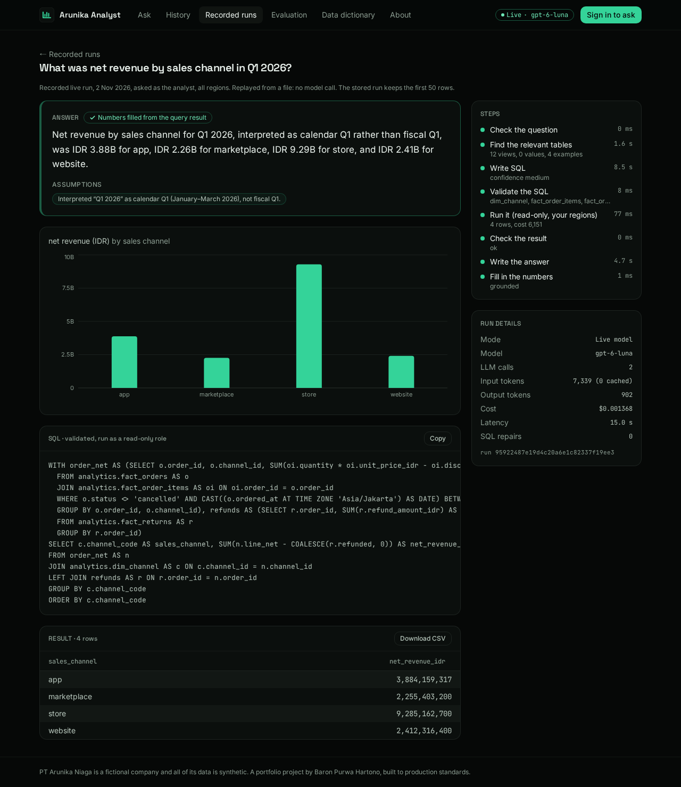
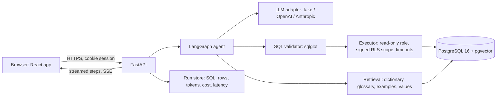

# Agentic SQL Analyst

Ask a company database questions in plain English or Bahasa Indonesia, and get answers you can check: the SQL, the rows behind it, and numbers filled in by code, never typed by the model.

**Live demo: [arunika-sql.duckdns.org](https://arunika-sql.duckdns.org).** Click **Try as analyst** (sees all regions) or **Try as manager** (sees only the Jabodetabek region); no account or password is needed. Live answers come from `gpt-6-luna`, with limits shared by all visitors: 5 questions a minute per demo account and $0.50 of model spend a day (the day starts at midnight WIB). If the limit is reached, the public **Recorded runs** page replays real live answers for free.

> A portfolio project built to production standards. The company, **PT Arunika Niaga**, is fictional, and all of its data is synthetic, generated by a deterministic script. No real people or businesses are involved.



_A real `gpt-6-luna` run from 2 Nov 2026, replayed on the app's public Recorded runs page: the answer with the assumption it made, the chart, the validated SQL, the rows, each step's time, and the tokens and cost. More: [the same run on a phone](docs/screenshots/recorded-answer-mobile-375.png) · [a delete request refused by the rule-based guard before any model call](docs/screenshots/recorded-refusal-desktop-1280.png)._

## Guarantees

All four are built and tested without an API key (see [docs/SECURITY.md](docs/SECURITY.md) for the threat-to-test table). How well a live model answers is measured separately: see [Evaluation](#evaluation).

1. **Read-only by construction:** SQL validator, read-only transaction, and read-only database role. Tests disable two layers at a time and show the third still blocking writes.
2. **You only see what you're allowed to see:** row-level security enforced by Postgres with an HMAC-signed region scope, so a regional manager sees zero rows from other regions even with hand-written SQL that bypasses the validator.
3. **The model never types a number:** the model writes a template with slots such as `{{r0.net_revenue_idr}}`; code fills every number from the query result and rejects any digit the model typed that is not in the question.
4. **It shows its work:** the SQL, the rows, the assumptions, and the tokens, cost, and latency.

## How it works



One question, step by step:

1. **Guard the input.** Fixed rules in English and Indonesian refuse write requests, personal-data requests, and prompt-injection phrasing before any model call.
2. **Retrieve context.** Hybrid search (BM25 + multilingual embeddings in pgvector) picks the relevant views, columns, metric definitions, few-shot examples, and matching values ("Surabaya", "marketplace").
3. **Write SQL.** The model returns structured output: SQL plus its assumptions, or a refusal if the question can't be answered from the data.
4. **Validate.** The sqlglot validator allows one `SELECT` over the documented `analytics` views only: no writes, no system catalogs, no personal-data columns, and only allow-listed functions.
5. **Execute.** As the read-only `nlq_reader` role, in a read-only transaction with a 5 s timeout, a cost check, a row cap, and a signed region scope that Postgres row-level security checks.
6. **Check the result.** Empty or suspicious results, and database errors, go back to step 3 with the reason (at most 3 repairs).
7. **Answer.** The model writes a template with slots; code fills in every number and formats it ("IDR 1.23B", "Rp 1,23 miliar", "Maret 2025"). A template with a typed number is rejected.

A budget guard sits on every edge of the graph (model calls, tokens, cost, wall time): when a limit is reached, the run stops cleanly and returns what it has. More in [docs/ARCHITECTURE.md](docs/ARCHITECTURE.md).

## The web app

- **Ask:** the agent's steps stream in as they finish, then the answer, an automatic chart, the SQL, a sortable table with CSV download, and the run details. A badge in the header shows what answers right now: a live model (`gpt-6-luna`) or the keyless stand-in.
- **History:** your stored runs, each labelled with its mode and model. A one-click demo sign-in sees only the runs from its own browser session.
- **Recorded runs** (public): real live answers replayed from a committed file, so anyone can read them without signing in or spending anything. The same runs are in [docs/RECORDED_RUNS.md](docs/RECORDED_RUNS.md).
- **Evaluation** (public): the test-split results below, read from the committed result files.
- **About** (public) explains how to use the demo and how the agent works; the **Data dictionary** (after sign-in) lists every view and metric.

## Evaluation

Test split, 60 questions × 3 repeats, `gpt-6-luna`, run on 2026-11-01. Full tables, caveats, and the result file behind every number are in [docs/EVAL_RESULTS.md](docs/EVAL_RESULTS.md). The web app's public Evaluation page shows the same results.

| System | EX relabeled | Answers with typed numbers, per run | p50 | $ / question |
|---|---|---|---|---|
| Agent | 0.933 ± 0.023 | 0 | 7.3 s | 0.000507 |
| Single-prompt baseline | 0.953 ± 0.031 | 48.3 ± 1.2 | 5.3 s | 0.000292 |

- **On this small schema the agent is not more accurate than the baseline:** the difference is within noise. What it adds is that every figure is filled in by code, so none needs checking by hand.
- **Null results:** removing retrieval, repair, or few-shot examples didn't change accuracy measurably here.
- **Negative result:** an optional critic step lowered EX to 0.873 ± 0.023 and stays off.
- **Model comparison:** `gpt-4o-mini` scored 0.733 ± 0.046 (run on 2026-11-02) at a higher cost per question.
- **Safety:** every run blocked 100% of unsafe requests.

**Read real answers:** [docs/RECORDED_RUNS.md](docs/RECORDED_RUNS.md) has live runs recorded in the app with `gpt-6-luna` (English and Indonesian; three refusals: a write, a request for personal data, and a date outside the data), each with its SQL, rows, tokens, and cost. They are hand-picked examples, not a benchmark.

## Run it locally (keyless)

Requires [Docker Desktop](https://www.docker.com/products/docker-desktop/) (running), [uv](https://docs.astral.sh/uv/getting-started/installation/), [Node.js LTS](https://nodejs.org/), and Git. Ports 5432, 8000, and 5173 must be free.

```bash
git clone https://github.com/Baron197/agentic-sql-analyst.git && cd agentic-sql-analyst
uv run poe setup   # .env with random secrets, Postgres + synthetic data + retrieval index, web packages
uv run poe demo    # API + web app; open http://127.0.0.1:5173 and click "Try as analyst"
```

The first `setup` takes a few minutes: it downloads Python and npm packages, the Postgres image, and a 220 MB embedding model. `Ctrl+C` stops the demo; `uv run poe db-down` stops Postgres.

**Keyless** means a rule-based stand-in answers instead of a model: no API key, no cost. It answers the demo questions offered on the Ask page (also listed by `uv run poe ask`), runs them through the same validator, executor, and row-level security, and refuses anything else. It shows the plumbing, not model quality.

More commands:

```bash
uv run poe check          # lint + tests (database tests skip if Postgres is down)
uv run poe ask "What was net revenue by sales channel in Q1 2026?" --user manager_jakarta
uv run poe eval --system gold --split dev   # the eval harness: golden SQL against the database, keyless
uv run poe                # every task
```

**Live mode makes paid model calls.** For one question: `uv run poe ask "…" --mode live --model gpt-6-luna` (needs `OPENAI_API_KEY` in `.env`). For the API and web app: set `LLM_PROVIDER=openai`, `OPENAI_API_KEY`, and `LIVE_MODE_ENABLED=true` in `.env`; `DAILY_BUDGET_USD` caps the spend per day. The production stack (Caddy, hardened containers) and the AWS setup are in [docs/DEPLOYMENT.md](docs/DEPLOYMENT.md).

## Design decisions and trade-offs

Every non-obvious choice is in [docs/DECISIONS.md](docs/DECISIONS.md) (54 entries, each with the alternatives considered). The main ones:

- **Safety and evaluation before the agent.** The validator, read-only role, and row-level security were built and attacked before any model code; the eval harness and a single-prompt baseline came before the agent, so every agent feature was measured against it.
- **Row-level security in Postgres, not in the prompt** (D012, D013). The region scope is HMAC-signed per transaction, so even SQL that slipped past every other layer sees only its own region. A missing or forged scope returns zero rows.
- **The executor runs SQL regenerated from the parsed tree** (D015), never the model's text, so Postgres sees exactly what the validator checked.
- **Templates instead of typed numbers.** It costs a second model call per answer; in exchange, no figure in an answer can be invented.
- **Held-out test split, used once** (D044). No tuning after the test run, and its questions are never few-shot examples. Null and negative results are published.
- **Model by accuracy against cost and latency** (D043). `gpt-6-luna` beat `gpt-4o-mini` by 20 points of EX and was cheaper per question.
- **One small server with hard spend limits** (D046, D047). A $0.50 daily cap, a kill switch, and a rate limit bound the cost of a public demo; the database is rebuilt from a deterministic seed, so it needs no backups.

## Limitations

- **Small, clean schema.** 22 documented views of a synthetic retailer. On this schema a single prompt is as accurate as the agent; a larger, messier schema is where retrieval and repair should matter, and that is not measured here.
- **60 test questions.** One question is 2 points of EX, so differences under about 5 points are noise.
- **One OpenAI model family evaluated.** The Anthropic adapter exists and is tested keyless, but was not run on the test split.
- **One server.** No high availability; rate limits live in memory in one process (D032). Sessions are stateless JWTs, so a copied token stays valid until it expires (D033).
- **No monitoring or alerts** beyond the signed-in `/api/metrics` page; [DEPLOYMENT.md](docs/DEPLOYMENT.md#spending-alerts) has the steps for billing alerts.
- **Single-turn questions.** No follow-ups ("and by channel?") or clarifying questions yet.

## Roadmap

- Clarifying questions for ambiguous requests, paused with a LangGraph interrupt.
- One follow-up turn that refines the previous query.
- An MCP server (`ask_database`, `describe_schema`).
- A public benchmark (BIRD mini-dev) for a number comparable with published results.
- Run the Anthropic adapter on the test split.
- MLOps: store the prompt version and git commit with every app run (eval results already record the commit); uptime and error-rate alerts; a small live regression check before each deploy; a tracing backend (Langfuse, LangSmith, or MLflow).

## Documentation

| | |
|---|---|
| [ARCHITECTURE.md](docs/ARCHITECTURE.md) | components, the agent graph node by node, data flow, where everything lives |
| [SECURITY.md](docs/SECURITY.md) | the 8 safety layers and the threat-to-test table |
| [EVAL_RESULTS.md](docs/EVAL_RESULTS.md) | the evaluation: method, results, ablations, failures read by hand |
| [DATA.md](docs/DATA.md) | the fictional company and its synthetic data |
| [DEPLOYMENT.md](docs/DEPLOYMENT.md) | the AWS setup, operations, and monthly cost |
| [DECISIONS.md](docs/DECISIONS.md) | design decisions with context and alternatives |
| [RECORDED_RUNS.md](docs/RECORDED_RUNS.md) | real live answers with their SQL, rows, and cost |
| [PROGRESS.md](PROGRESS.md) | build log, phase by phase |

## Stack

Python 3.12 (uv), LangGraph, FastAPI, PostgreSQL 16 + pgvector, sqlglot, fastembed, React + TypeScript + Vite, Docker Compose, Caddy, GitHub Actions, AWS EC2.

## License

[MIT](LICENSE). The company and all data in this repository are fictional and synthetic.
