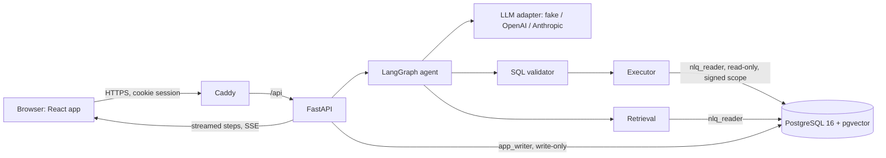
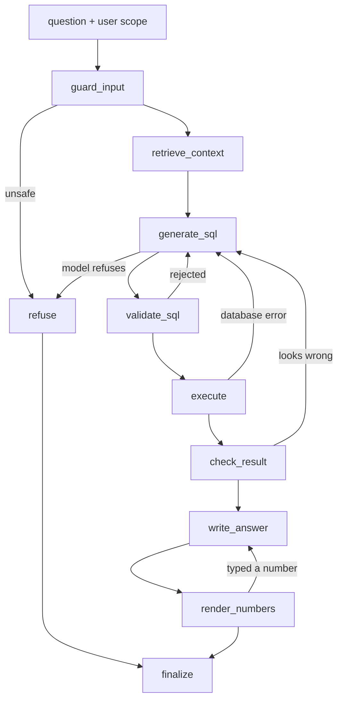

# Architecture

How a question becomes a checked answer: the components, the agent graph node by node, the safety layers it passes, and where each part lives in the code. PT Arunika Niaga and all its data are fictional and synthetic.

## Components



| Component | Job | Code |
|---|---|---|
| Web app | Ask, History, Recorded runs, Evaluation, About, Data dictionary pages; renders the streamed steps, answer, chart, SQL, and table | `web/src/` |
| API | Cookie sign-in, `POST /api/ask` and `/api/ask/stream`, run history, limits, metrics | `backend/src/sql_analyst/api/` |
| Agent | The LangGraph state machine below | `backend/src/sql_analyst/agent/` |
| LLM adapters | One interface (`generate_structured`) for fake, OpenAI, and Anthropic; records tokens, cost, and latency for every call | `backend/src/sql_analyst/llm/` |
| Retrieval | Hybrid BM25 + vector search over the dictionary, glossary, few-shot examples, and categorical values | `backend/src/sql_analyst/retrieval/` |
| Safety | Validator, cost guard, executor, signed scope | `backend/src/sql_analyst/safety/` |
| Database | `core` (22 tables, raw, with personal data), `analytics` (22 documented views, no personal data), `retrieval`, `app` | `backend/src/sql_analyst/db/` |
| Data dictionary | Every view, column, metric, and join path; the single source for the validator, retrieval, and prompts | `data/dictionary.yaml` |
| Eval harness | Golden set, baseline, agent, ablations, reports | `eval/` |

The database has three logins, each with one job:
- `postgres` (owner): builds the schemas and loads the seed. Never used by the API.
- `nlq_reader`: the agent's login. `SELECT` on the `analytics` views only, read-only by default, 5 s timeout.
- `app_writer`: the API's run store. Reads and writes the `app` schema only; it cannot read `analytics`.

## One request

1. **Sign in.** The browser gets a JWT in an `HttpOnly` cookie (`SameSite=Lax`, `Secure` on HTTPS). The token carries the user and, for a demo sign-in, a random session id that keeps History private to that browser session (D033, D048).
2. **Limits, in order** (`api/deps.py`): the kill switch (503 when live mode is off), the per-account rate limit (429), and the daily spend cap read from stored runs (429). A refused question costs nothing.
3. **The agent runs** with the user's region scope. With `/api/ask/stream`, each node is sent as a `step` event as soon as it finishes, then `sql`, `rows` (first 200), `answer`, and `done` (`api/streaming.py`).
4. **The run is stored** in `app.runs` by `app_writer`: question, SQL, rows, answer, per-node timings, per-call tokens and cost, mode, and model. History, `/api/metrics`, and the daily cap read from it.

## The agent graph



Every edge passes through a budget guard (`agent/budget.py`). It checks the model-call limit before entering a node that calls the model, and tokens, cost, and wall time after each node. When a limit is reached, the run goes to `budget_stop`, then `finalize`, and ends with status `partial` and whatever is ready (the table, if a query ran). Default limits per run: 8 model calls, 60,000 tokens, $0.05, 60 s, 3 repairs (D029).

| Node | What it does | Model call |
|---|---|---|
| `guard_input` | Fixed rules in English and Indonesian refuse write requests, personal-data requests, prompt-injection phrasing, and over-long input | no |
| `retrieve_context` | Hybrid search picks the views, columns, glossary metrics, join paths, matching categorical values ("Jkt" → `JKT`), and similar few-shot examples | no |
| `generate_sql` | Structured output: SQL, assumptions, and a decision (answer, `refuse_unsafe`, `refuse_unanswerable` with suggested follow-ups). On a repair, the previous SQL and the reason it failed go back in | yes |
| `validate_sql` | The sqlglot validator (below) | no |
| `execute` | Validates again, then runs the regenerated SQL as `nlq_reader` | no |
| `check_result` | Deterministic checks: no rows, a column that is NULL in every row, implausibly large numbers (join fan-out), negative counts, the row cap reached. An optional critic call exists but is off (it lowered accuracy, D044) | no (critic off) |
| `write_answer` | The model writes an answer template with slots such as `{{r0.net_revenue_idr}}`, plus a chart suggestion | yes |
| `render_numbers` | Code fills every slot from the result and formats it ("IDR 1.23B", "Rp 1,23 miliar", "Maret 2025"). A template with a digit that is not in the question is rejected: one retry, then the answer is the table alone | no |
| `refuse`, `budget_stop`, `finalize` | End the run with the refusal, the stop reason, or the answer, and build the result | no |

A normal answer therefore makes two model calls. Repairs are capped at 3 per run; if no repair is left but an earlier attempt produced a result, the answer uses it with a caveat.

**Keyless mode** (`agent/keyless.py`) replaces the model with a rule-based stand-in that replays hand-written SQL and templates for the questions in `data/demo.yaml`. Every other node runs for real, so keyless runs exercise retrieval, the validator, the executor, row-level security, and rendering with no API key. They test the plumbing, not answer quality.

## Safety layers

Full detail and the threat-to-test table: [SECURITY.md](SECURITY.md).

| # | Layer | Stops |
|---|---|---|
| 1 | Input guard | write and personal-data requests, injection phrasing, before any model call |
| 2 | SQL validator (sqlglot AST) | anything but one `SELECT` over documented `analytics` views; writes hidden in CTEs; system catalogs; personal-data columns; functions not on the allow-list; lookalike Unicode |
| 3 | Row cap | results over 1,000 rows (flagged as truncated) |
| 4 | Cost guard | query plans above a cost limit (`EXPLAIN`) |
| 5 | Executor and role | writes (read-only role and read-only transaction), slow queries (5 s timeout) |
| 6 | Row-level security | rows outside the user's region, even for SQL that slipped past every other layer |
| 7 | Hostile data | instructions inside data: rows reach the model as escaped JSON, and answers are templates filled by code |
| 8 | Budget and limits | runaway runs and spend: per-run budget, per-account rate limit, daily cap, kill switch |

The executor never runs the model's text. It runs the SQL regenerated from the parsed tree, with comments removed, so Postgres sees exactly what the validator checked (D015).

**Row-level security.** Postgres policies sit on the `core` tables and apply to the role that owns the `analytics` views, so everyone who reads a view is scoped, the admin included. For each query the executor sets the user's region ids and an HMAC of them bound to the database connection and transaction. The policies recompute the HMAC with a key that no query role can read. A missing, forged, or replayed scope returns zero rows (D012, D013).

## The model never types a number

The baseline (one prompt that writes SQL and the answer) typed numbers in 48.3 ± 1.2 answers per run of the 60 test questions (nearly all of the 49 or 50 answers it wrote), and each one would need checking by hand. The agent's answer step writes a template instead, and `agent/render.py` fills every slot from the result rows; a template in which the model typed a digit that is not in the question is rejected. Grounding is scored on the text the model typed, so the check covers exactly what the model wrote (D027). Assumptions keep a figure only if it also appears in the question or the executed SQL.

## Retrieval

- **Corpus** (`retrieval/corpus.py`): one chunk per view, column, glossary metric, and few-shot example, built from `data/dictionary.yaml` and `data/examples.yaml`. Categorical values (cities, stores, categories, channels) are stored for fuzzy matching. No test-split question is ever a few-shot example; a test fails if one leaks (`eval/leakage.py`).
- **Search** (`retrieval/search.py`): BM25 and vector similarity (`paraphrase-multilingual-MiniLM-L12-v2` via fastembed, run locally, no API key), fused by reciprocal-rank fusion. The views a matched metric needs, and the views that join the selection together, are added.
- **Index:** pgvector in the `retrieval` schema, built by `poe index-build` (D025).

On this small schema, removing retrieval (sending the whole schema) did not change accuracy measurably; see [EVAL_RESULTS.md](EVAL_RESULTS.md).

## Observability and cost

- Each node records its duration; each model call records input, cached, cache-write, and output tokens, cost (from `llm/pricing.py`), and latency (`observability.py`).
- The API stores every run in `app.runs`; the CLI writes JSONL under `runs/` (gitignored).
- `GET /api/metrics` (signed in): runs, error rate, p50/p95 latency, cost today, cache use.
- API logs are JSON lines with no question text or secrets (`api/logs.py`).

## Evaluation harness

`uv run poe eval` runs a system (`gold`, `baseline`, or `agent`) on the dev or test split of the golden set (`eval/cases/`, 40 dev and 60 test questions) and writes a JSON and a Markdown report to `eval/results/`, with the date, commit, model, and repeats. It scores execution accuracy three ways (strict, lenient, relabeled), safety, false refusals, grounding, latency, and cost, and checks that the database is unchanged after the run. Live runs need `--confirm-live` and print a cost estimate first (D021). Method and results: [EVAL_RESULTS.md](EVAL_RESULTS.md).

## Deployment

One AWS EC2 `t4g.small` runs Docker Compose: Caddy (the built web app, HTTPS, the `/api` proxy), the API, and Postgres, which is not published to the host. The API and web containers run as non-root on read-only filesystems with every capability dropped. Setup, operations, and cost: [DEPLOYMENT.md](DEPLOYMENT.md).

## Tests and CI

GitHub Actions runs three jobs on every push, all without an API key:
- `backend`: ruff, the workflow schema check, pytest with Postgres (database tests are required in CI, D004), and a keyless Playwright smoke test of the web app against the API;
- `web`: lint, Prettier, typecheck, Vitest, and build;
- `docker`: builds the production stack, seeds it, and runs `infra/smoke_public.py` through Caddy.

## Code map

```
backend/src/sql_analyst/
  agent/        graph.py (nodes and edges), nodes/, budget.py, guard.py, render.py, keyless.py, prompts/
  api/          main.py, routes/, deps.py (limits), auth.py, streaming.py, store.py, ratelimit.py
  llm/          base.py (interface), openai.py, anthropic.py, fake.py, pricing.py
  retrieval/    corpus.py, embed.py, search.py, index.py
  safety/       validator.py, executor.py, cost_guard.py, scope.py
  db/           schema.sql, views.sql, security.sql, app.sql, load.py, seed/
  dictionary/   loader and renderers for data/dictionary.yaml
  cli.py        `poe ask`
eval/           run_eval.py, metrics.py, report.py, cases/, results/
web/src/        pages/, components/, api/
infra/          Dockerfiles, docker-compose.prod.yml, Caddyfile, make-env.sh, smoke_public.py
data/           dictionary.yaml, examples.yaml, demo.yaml, recorded_runs.json, eval_summary.json
```
